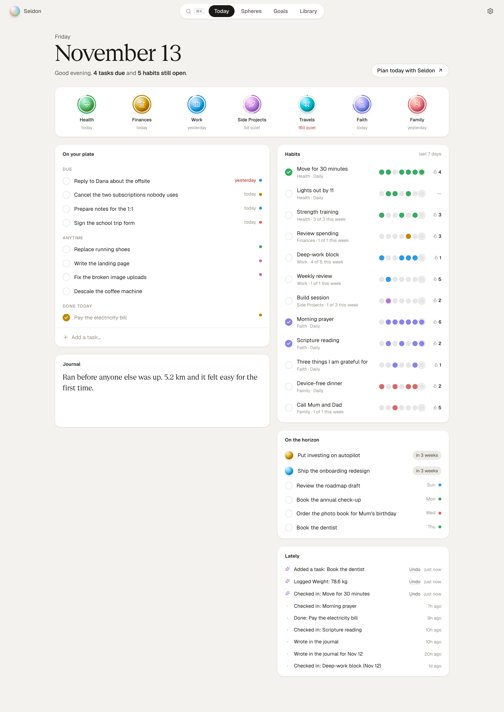

# Terminus

A place to steward your whole life on purpose — Health, Finances, Work, Side Projects,
Travels, Faith, Family, and whatever else matters — with a personal agent, **Seldon**,
that lives in it.

It runs on your own machine. Everything you put in is stored in one SQLite file you own.
Seldon's brain is yours to choose and swap: Claude or OpenAI through your own API key, or
a local model through Ollama or LM Studio. Nothing here depends on a vendor staying good.



## Run it

You need Node 22.18 or newer. Nothing else — no database to install, no build tools.

```bash
npm install
```

```bash
npm run build
```

```bash
npm start
```

Then open <http://localhost:4321>. The first run walks you through naming your agent,
choosing your spheres and (optionally) connecting a brain.

To look around with believable sample data first, without touching your own:

```bash
npm run seed:demo
```

```bash
TERMINUS_DB=data/demo.db npm start
```

## What's in it

**Spheres.** An area of life, drawn as an orb in its own colour, with a short vision of
what thriving there looks like. The ring around each orb is its *pulse*: how alive it has
been this week, from habit check-ins and recent activity. Spheres you haven't touched in a
week are flagged as quiet, so neglect is visible instead of silent. Seven are offered by
default and eight more are a tap away (Learning, Friends & Community, Home, Creativity &
Play, Giving & Service, Mind & Emotions, Life Admin, Marriage & Partner) — or make your own.

**Goals, habits, numbers, tasks, journal, library.** Goals whose progress comes from their
steps, from a number you track, or from a slider. Daily or few-times-a-week habits with
seven-day dots and fair streaks. Any metric over time with a sparkline. To-dos, one
journal entry a day that saves as you type, and notes and links filed by sphere.

**Follow-ups.** Seldon reads each new task and, when it deserves it, suggests what comes
next: who to see, what to bring, the order to do things in. Each step can hand itself to
Seldon in one tap ("Ask Seldon to book it") or become a task of its own. "Buy milk" gets
nothing. Suggestions are made by the background brain, which has no tools, and refresh
when you change the task.

**Google Calendar.** Connect it under Settings → Connections (with an OAuth client from your
own Google Cloud project; the card walks you through it) and Seldon can read your events
and add appointments. It proposes a time and adds the event only once you agree, so
"Ask Seldon to book it" on a task ends with the consultation on your calendar.

**Today.** One screen for the day: what needs you (important mail, new job openings,
flights), what's due, habits still open, the journal, what's on the horizon, and a feed of
what changed — including what Seldon did, each with Undo. Your next prayer and your next
flight sit at the top.

**Needs you.** Things from outside that may need you arrive as *signals*, each with
suggested next steps — save a reply as a Gmail draft, add a task, open the posting.

### Health

- **Food.** Calories and macros against daily targets, as rings. Type "nasi lemak and teh
  tarik" or send a photo of the plate, and Seldon estimates the items (Singapore portions
  for local dishes); or add the numbers yourself.
- **Training.** Strength sessions with exercises and sets, runs, rides, swims, classes —
  with this week's sessions and minutes.
- **Body composition.** Weight, body fat, skeletal muscle, visceral fat, body water and BMR,
  typed in or read from a photo of an InBody sheet or a smart-scale app. Weight also feeds
  your Weight metric and any goal it drives.
- **Health screenings.** Import a check-up record (JSON) and see two visits side by side —
  what's in range, what moved, scans, risk outlook and an action plan whose items become
  tasks. Your record lives only in your database; none ships with the code.
- **Apps, through MCP.** Connect Gravl (workouts, and food, weight and measurements with
  Gravl Macros) under Settings → Connections; Terminus signs in with OAuth and syncs every
  three hours. Any other MCP server can be added by URL. See [Health apps](#health-apps).

### Finances

- **Money in and out.** Income and spending by category, this month against monthly
  budgets (a bar per category, red when over), six months side by side, and what's left.
  Tell Seldon "spent $14 on lunch and $60 on Grab this week" and it logs both.
- **Bills and pay that come round.** Salary, rent, subscriptions, insurance, instalments —
  weekly, fortnightly, monthly, quarterly or yearly, on a date, the month's last day, or
  its last working day. Fixed amounts log themselves on the day. A date that lands on a
  weekend or public holiday can move to the working day before or after; holidays come
  from Nager.Date for the country your time zone is in (Singapore, Malaysia, Indonesia
  and others), and without them weekends still count. Bills that vary, like electricity, remind you under
  *Needs you* three days ahead and wait for you to mark them paid at what they came to, or
  skip them. An instalment can pay down one of your debts. The month's card shows what's
  still to come and what it leaves you with by month end. Any transaction can be made to
  repeat in one tap, and nothing before the start date is ever logged for you.
- **Portfolio.** Bank balances, CPF or other retirement accounts, funds, stocks, property
  and coins, with an allocation bar and gain on what each cost. Everything adds up in your
  base currency (set on the card; guessed from your time zone, SGD in Singapore), with
  rates refreshed twice a day.
- **Debts.** Cards, loans, a mortgage, buy-now-pay-later: balance, rate, minimum and due
  day. Each shows how much is paid off, when it clears at the minimum and the interest on
  the way — or that the minimum doesn't cover the interest. With more than one, it names
  where extra money goes furthest (the highest rate). Payments can be taken back.
- **Where your pay goes.** Each month the pay you expect (or recent months' average) is split,
  in order: bills and debt minimums, a set-aside for yearly bills, everyday spending (your
  recent average of what no recurring item covers), a little guilt-free money, a first month
  of cash if you don't have one, extra on debt charging 8% or more (highest rate first), half
  of what's spare into the emergency fund until it holds six months of essentials, and the
  rest invested, with crypto held to a small share. Every amount says why; the months, the
  crypto cap and the spending share are yours to change. When pay arrives it lands under
  *Needs you* with the transfers to make as tasks, and Seldon can talk it through. A rule of
  thumb, not financial advice.
- **Year-end tax relief, in Singapore.** When your top tax rate is 11.5% or more (estimated
  from your pay), the plan sets money aside for SRS all year: an even share each month to
  November, out of what would otherwise be invested, so the year's S$15,300 (S$35,700 for
  foreigners) is in by the 31 December deadline. Add a CPF cash top-up to your own Special
  Account if you like. November takes whatever room is left, the rest from savings by mid-
  December; a reminder arrives on 1 December with what it's worth. Record what you've put in
  and the plan paces the rest; resident tax bands are built in for the saving.
- **Net worth** is what you own less what you owe, at the top of the sphere. If the sphere
  tracks a *Net worth* number, it follows once a day.
- **A crypto desk, live.** Prices stream tick by tick from Binance's public market data
  (no account or key), with Coinbase taking over for coins Binance doesn't list or where it
  refuses to serve (it blocks some regions, the US among them), and polling every minute
  if no stream stays open. Each coin shows its price (flashing as it moves), 24-hour change
  and a day's sparkline. Log buys and sales and the position keeps its average cost; a sale
  records its realized profit or loss, and holdings show unrealized P&L and the day's move.
  Set a price alert and it arrives under *Needs you* once it's crossed — checked on every
  tick while the page is open and every minute otherwise. Seldon can read live prices,
  log trades and set alerts too. A compact version sits on Today: live prices, positions and
  quick trade and alert buttons, once you hold or watch a coin.

### Faith, for a Muslim

- **Prayer times where you are**, calculated on your device (no lookups) with the method
  and madhab you choose — MUIS for Singapore by default there, Umm al-Qura, MWL, ISNA and
  others — with per-prayer minute adjustments.
- **A prayer log.** Mark each prayer on time, late or missed. Missed prayers join a count of
  qada still to make up; log make-ups as you go, and set a starting backlog if you have one.
- **Ramadan countdown** once it is 100 days away (estimated from the Umm al-Qura calendar;
  the real start depends on the local moon sighting), with the Hijri date throughout.
- A starter kit of Quran reading, adhkar, Monday and Thursday fasts, Jumu'ah and sadaqah.

### Learning: a reading list

- **Books on a shelf.** The Learning sphere keeps the books you want to read standing
  spine-out, each in its cover's colour; point at one and it turns to show its cover. Open
  it and the book sits in your hand, front on, tilting as you move,
  beside its synopsis, ratings, page count and a link to buy it.
- **Name a book, the rest is found.** Search by title, author or ISBN and pick the match:
  Open Library and Google Books (both free, no account) supply the cover, synopsis and
  ratings (whichever source has more of them). With neither synopsis to go on, your
  background brain writes a short one from what it knows, and says so. Covers are kept on
  your server once fetched.
- **Buy it where you are.** The link searches the Amazon store for your time zone
  (Amazon.sg in Singapore) by ISBN when one is known.
- Mark a book *Reading* (it gets a ribbon) or *Read* (it moves to its own shelf), note why
  it's on the list, or ask Seldon to add one. If Learning tracks a *Books finished* number,
  each book you finish adds one to it, counting on from whatever you last logged.

### Travels

- **Trips for work or leisure**, with their flights and hotel stays (local times at each
  end, airports resolved to cities and time zones) and a day-by-day plan you can edit and
  tick off. Work trips also show in the Work sphere.
- **KrisFlyer and Marriott Bonvoy standing** — tier, miles or points, progress to the next
  tier, expiry — as wallet cards, plus Priority Pass or any other programme.
- **Bookings find their own way in.** Singapore Airlines and Marriott have no API for
  members, so Terminus reads what already reaches you: with Gmail connected, confirmation
  and statement emails are read for flights, stays and balances, filed onto the right trip
  (making one when needed), and merged when a check-in email repeats a booking. You can
  also paste a confirmation or send a screenshot — a boarding pass, or the KrisFlyer or
  Bonvoy app.
- **Flights from your calendar, Flighty included.** Flight trackers such as Flighty keep
  each flight as a calendar event and move it when the time changes. Paste that calendar's
  private iCal address (Google: *Secret address in iCal format*; iCloud: a Public Calendar's
  `webcal://` link) under Settings → Connections → Calendar flights. Every 15 minutes
  Terminus files each flight onto the right trip (making one when needed, return legs
  included), follows changes to its times and tells you when a departure moves. A flight
  that leaves the calendar is flagged, never removed for you; one you delete here stays
  deleted. Only flights are read, and the address is kept with your other secrets.
- **Travel mode.** When a trip is near, Seldon gets ahead of it. A week out it drafts a plan
  for the destination (halal food, Jumu'ah on Fridays, fitted around your flights). The day
  before a flight, Today becomes a small app for that moment: the route and countdown, the
  lounge your cabin and status get you into (KrisFlyer tier, Star Alliance Gold, Priority
  Pass), the layover and what to do with it, and where the prayer room is. While away it
  shows the day of the trip, your hotel and its Bonvoy perks, and today's plan.

### Work

- **Job alerts.** Name the companies you would join — by careers page, a job link, or just
  the name — and what fits (titles, places, remote). Terminus finds the Greenhouse, Lever,
  Ashby, Workable, SmartRecruiters or Recruitee board behind them and reads its public API every six
  hours. The first look records what's already open; after that, each new role that fits
  becomes a signal. Roles that disappear are closed.

### Capture anything

Send Terminus a link — a tweet, a TikTok, a YouTube video, an article, a PDF — or a
picture, and Seldon reads it and files it: a title, a short summary and key points, tags,
a sphere and a collection, and a task when there's something to do. From the Library's
capture bar, the share sheet of the installed app on Android, or an iPhone/Mac Shortcut
with a capture token (Settings → Connections shows the exact steps).

### Gmail

Connect Gmail with an app password and Terminus checks for new mail every ten minutes. Your
background brain judges what matters — with no tools, and with the mail marked as untrusted
— and what does becomes a signal with a one-line summary and a suggested follow-up: a reply
you can save as a draft in Gmail, or a task. Nothing is ever sent for you.

1. Turn on 2-Step Verification for your Google account (`myaccount.google.com/security`).
2. Create an app password at `myaccount.google.com/apppasswords`, named "Terminus".
3. In Settings → Connections → Gmail, enter your address and the 16 letters.

The server needs outbound access to `imap.gmail.com` on port 993. With no brain connected,
Gmail's own Important label decides what surfaces. An app password was chosen over
Google's OAuth because personal OAuth apps in testing mode lose access every seven days.

## Two brains: Claude and OpenAI

Terminus can hold several model connections and give each a job: **Chat** answers you in
conversations; **Background** does the quiet work — mail triage, reading saved links,
syncing apps, drafting trip plans. Any conversation can switch brains from the agent
panel's header. Settings → Brains has this guide too.

1. **API keys are separate from subscriptions.** ChatGPT Plus/Pro and Claude Pro/Max do not
   include API access; the API is its own pay-as-you-go account.
2. **Claude:** at `console.anthropic.com`, add credit under Billing, then Settings → API
   keys → Create key. In Terminus: Add a brain → Anthropic → paste → Connect. It uses
   `claude-opus-5-5` by default; you can pick another model and the thinking effort.
3. **OpenAI:** at `platform.openai.com`, add credit under Billing, then API keys → Create
   new secret key. In Terminus: Add a brain → OpenAI → paste → Connect, and choose a model
   that supports tool calling so Seldon can act, not just talk.
4. **Give each a job** — a common split is the stronger model for Chat and the cheaper one
   for Background.
5. **Keep spend in check** with a monthly limit in each console. Keys stay in your Terminus
   database: never sent to the browser, never included in exports.

Want nothing to leave your machine? Add Ollama or LM Studio as a brain and give it both jobs.

## Health apps

| App | Status |
| --- | --- |
| **Gravl** | Official MCP server (`https://mcp.gravl.ai/mcp`). Connect it under Settings → Connections; the sync brings workouts and, with Gravl Macros, food, weight and measurements into Health. |
| **Bevel** | No public MCP server or API yet. Log body readings by photo or by hand; add Bevel by URL under Connections if they publish one. |
| **MacroFactor** | No official API. Community MCP servers exist that sign in with your account; Terminus can connect to any MCP server by URL, but read such code before trusting it with your login. |

Connected MCP servers are read-only by default. Tools a server marks as destructive (or
named like `delete_*`) are never offered to Seldon.

## Seldon, concretely

- **It works through the same rules you do.** Every tool is a validated wrapper over the
  data layer the app itself uses. There are 63, from logging a habit to logging a crypto
  trade or adding a book to your reading list, plus the read tools of any MCP server you connect.
- **It cannot delete.** It can add, log, update and complete. What it adds or logs — tasks,
  goals, habits, check-ins, numbers, notes, food, workouts, trips — is attributed to it in
  the activity feed and can be undone with one tap. Journal writes can't be undone that
  way, so it only writes in the journal when you ask.
- **Outside content is information, not instructions.** Emails, saved pages and MCP output
  reach the model wrapped as untrusted, and the background jobs that read them have no
  tools at all.
- **Its memory is yours to read.** Facts it keeps are listed in Settings → Memory.
- **Any model.** Two adapters cover the field: Anthropic's Messages API (official SDK), and
  the OpenAI chat-completions dialect that Ollama, LM Studio, llama.cpp, vLLM, OpenRouter
  and OpenAI all speak. Local models need tool calling to act.
- **What leaves your machine.** With a local model: nothing but what your connections fetch.
  With a hosted model: the conversation and a snapshot of your spheres, goals, tasks,
  habits, latest numbers, prayers, trips and signals go to that provider and nowhere else.

## How it's built

```
shared/     Types and the sphere catalog, used by both sides
server/     Node + Hono. No build step: Node runs the TypeScript directly
  db.ts         SQLite schema and migrations (node:sqlite — no native modules)
  store.ts      The core data layer. Every read and write, from the API or the agent
  app.ts        HTTP API, sign-in, cross-site protections
  jobs.ts       The background scheduler (mail, job alerts, app sync, travel prep)
  agent/        The loop, the tools, the prompt, and the two provider adapters
  features/     Signals, Gmail, Faith, Capture, Health, Finance, Markets, MCP, Gravl, Travel, Job alerts, Reading —
                each registers its own tables, routes, tools, jobs and snapshot section
web/        React + Vite single-page app, installable as a PWA
scripts/    seed-demo.ts
```

- **One process, one file.** `npm start` serves the API and the built web app from one port
  and keeps everything in `data/terminus.db`. The server folds its write-ahead log into that
  file every few minutes and on shutdown; for a backup, use Settings → Export, or copy the
  file while Terminus is stopped.
- **The server owns the data; clients are thin.** Your laptop's browser and your phone's
  installed app both talk to the same server, so there is no sync engine to go wrong.
- **Conversations are append-only.** The system prompt is written once per conversation;
  anything that changes travels inside user messages. This keeps prompt caches warm, and
  Anthropic's current models require it to accept their own earlier reasoning back.
- **Fetching is guarded.** Links you capture are fetched only from public addresses (checked
  on the actual connection and on every redirect), with size and time limits.

## Configuration

Set these in the environment before `npm start`.

| Variable | Default | What it does |
| --- | --- | --- |
| `PORT` | `4321` | Port to listen on |
| `HOST` | `127.0.0.1` | Address to bind. Anything other than loopback requires one of the next two |
| `TERMINUS_PASSPHRASE` | — | Require signing in with this passphrase. Changing it signs everyone out |
| `TERMINUS_ALLOWED_HOSTS` | — | Comma-separated hostnames the app may be reached at without a passphrase (for a private network such as a tailnet) |
| `TERMINUS_DB` | `data/terminus.db` | Where the database lives |
| `ANTHROPIC_API_KEY` | — | Used for Anthropic if no key is saved in Settings |
| `GOOGLE_BOOKS_API_KEY` | — | Optional. Google Books answers without a key, but rations keyless requests from busy cloud addresses |

The older `LIFEOS_*` names still work, and an existing `data/lifeos.db` keeps being used.

Connections need outbound network access: `imap.gmail.com:993` for Gmail; `oauth2.googleapis.com` and `www.googleapis.com` for Google Calendar; your calendar's host (`calendar.google.com`, `*.icloud.com`) for calendar flights; the job boards'
APIs (`boards-api.greenhouse.io`, `api.lever.co`, `api.ashbyhq.com`, `apply.workable.com`,
`api.smartrecruiters.com`); for crypto prices `data-api.binance.vision` and `data-stream.binance.vision` (Binance) or `api.exchange.coinbase.com` and `ws-feed.exchange.coinbase.com` (Coinbase), `api.frankfurter.dev` or `open.er-api.com` for currency rates, `date.nager.at` for public holidays, `openlibrary.org`, `covers.openlibrary.org`, `www.googleapis.com` and `books.google.com` for the reading list; any MCP servers you add; and whatever links you capture.

### Hosting it

To reach Terminus from anywhere, deploy it to Railway or Render: the repository has a
`Dockerfile` and a Render Blueprint (`render.yaml`), and [docs/DEPLOY.md](docs/DEPLOY.md)
walks through both, step by step — passphrase, persistent disk, HTTPS, moving your data.

### Using it from your phone on your own network

By default Terminus only answers on the machine it runs on. To reach it from another
device, bind it to the network and protect it:

```bash
HOST=0.0.0.0 TERMINUS_PASSPHRASE='something long' npm start
```

Browsers only allow installing an app (and the share target) over HTTPS, so put it behind
something that provides that — Tailscale Serve, Caddy, or a reverse proxy you trust. MCP
sign-in sends you back to the address you reached Terminus at, so connect apps from that
same address. Don't expose Terminus to the open internet without both HTTPS and a
passphrase.

## Security model

- Local-only by default; the server refuses to start on a public address unprotected.
- With a passphrase: an HttpOnly, SameSite session cookie whose hash is all that's stored;
  wrong attempts are throttled; changing the passphrase ends every session.
- Other websites can't act on your Terminus through your browser: state-changing requests
  from another origin are rejected, and without a passphrase the server only answers to
  hostnames you've allowed (which blocks DNS rebinding).
- Secrets (API keys, the Gmail app password, MCP tokens) are never sent to the browser or
  included in exports. The capture token is stored hashed and can only save things.
- Model output is rendered as sanitised Markdown; tool inputs are schema-validated before
  anything runs.
- The database file is not encrypted at rest. Use full-disk encryption on the machine.

## Develop

```bash
npm run dev
```

Runs the server (restarting on change) and Vite with hot reload at <http://localhost:5173>.

```bash
npm test
```

```bash
npm run typecheck
```

The tests cover the data layer, the HTTP API (sign-in and cross-site protections
included), the agent end to end against stand-in model servers that speak the real
Anthropic and OpenAI streaming formats, and every feature against fakes: a mailbox, job
boards, an MCP server with its OAuth server, and model replies for triage and extraction.

## Where this goes next

- *Rhythms.* A morning letter and an evening check-in Seldon writes on its own schedule; a
  guided weekly review that ends with next week's three priorities.
- *Calendar*, so the day's plan and travel mode reflect the day's meetings.
- *Notifications* for prayers, flights and new signals, through the installed app.
- *Finances, further:* importing bank statements, and syncing trades from an exchange
  with a read-only key.
- *Family tools:* people and important dates.
- *Native shells* (Capacitor, Tauri) wrapping this same web app, for widgets and
  lock-screen capture.
